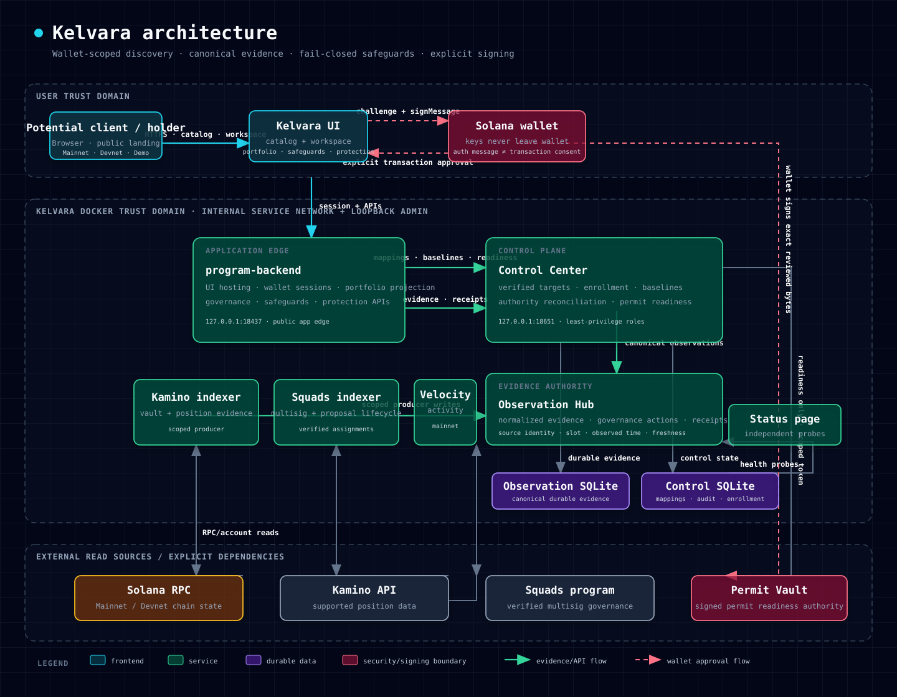

# Kelvara

**Evidence-driven protection for onchain yield positions.**

Kelvara discovers supported positions held by a Solana wallet, monitors the control assumptions behind them, explains material changes as safeguards, and prepares a constrained exit for explicit wallet approval.

Kelvara is non-custodial. It does not hold user assets or browser wallet keys. Observation is read-only. Authentication uses a wallet-signed message. Any transaction remains a separate, explicit wallet action.

<p align="center">
  
</p>

## The problem

A yield position can look healthy while its control plane changes underneath it. Upgrade authorities, multisig membership, thresholds, privileged proposals, and execution rights may change before a holder notices. Raw explorers expose fragments of this evidence, but they do not connect those changes to a holder's position or next decision.

Kelvara turns that fragmented evidence into a position-scoped answer:

1. **What do I hold?** Discover supported positions for the authenticated wallet.
2. **Who can change it?** Resolve verified governance and authority mappings.
3. **Has a monitored assumption changed?** Compare fresh observations with explicit baselines.
4. **What does that mean?** Show pass, review, breach, or unknown without hiding stale or unavailable evidence.
5. **What can I do?** Prepare and validate an exact exit path, then ask the wallet owner to approve it.

## User story

> As a holder of an onchain yield position, I want to know when the authority or governance assumptions behind my position change, understand the evidence, and retain control over any protective exit.

### Normal journey

1. The visitor opens the public landing page and selects **Mainnet**, **Devnet**, or **Devnet Demo**.
2. Kelvara shows only the supported catalog for that exact context. Catalog rows are not ownership claims.
3. The visitor connects a Solana wallet and signs a one-time authentication message.
4. Kelvara discovers eligible positions belonging to that wallet.
5. Verified target mappings connect each eligible position to its governance/control subject.
6. Indexers observe protocol state, Squads governance, and transaction velocity.
7. Observation Hub stores canonical evidence with source, slot, timestamps, and freshness.
8. The authenticated workspace shows portfolio, governance, safeguards, and protection readiness.
9. A control change becomes a safeguard finding only through the normal evidence pipeline—not by directly changing UI state.
10. If protection is available, Kelvara prepares and validates constrained transaction bytes. The wallet owner reviews, signs, and explicitly broadcasts.

### Quiet-state value

A green screen is not a guarantee. Kelvara reports what was checked, evidence freshness, unavailable coverage, and the closest relevant history. The intended wording is “No monitored condition is currently breached,” not “Everything is safe.”

## Potential client walkthrough

### Public, no wallet

Open:

```text
http://127.0.0.1:18437/index.html
```

Verify:

- network selector offers Mainnet, Devnet, and Devnet Demo;
- Mainnet displays supported Mainnet catalog entries;
- Devnet never falls back to Mainnet data;
- Devnet Demo is clearly labeled test data and makes no ownership claim;
- wallet-specific portfolio, governance, safeguards, and protection remain unavailable before authentication.

### Authenticated Mainnet

1. Select **Mainnet**.
2. Connect the intended wallet.
3. Review the wallet authentication challenge and sign the message.
4. Enter the authenticated workspace.
5. Open **Positions** to inspect eligible supported positions.
6. Open **Governance** to inspect linked Squads/control evidence.
7. Open **Safeguards** to inspect status, history, source, and freshness.
8. Open **Protection** to inspect readiness and the explicit approval boundary.

Wallet authentication proves wallet control for the session. It does not authorize a transaction.

### Devnet Demo

The real Devnet wallet journey is being completed as a bounded demonstration environment. Its contract is:

1. select Devnet Demo;
2. authenticate with a personal wallet;
3. receive the fixed, no-value `FUN USD` test asset;
4. approve activation of a real Devnet position;
5. observe that position through the normal Kelvara pipeline;
6. trigger one predefined Devnet-only authority incident;
7. wait for finalized chain state to flow through indexer, Observation Hub, evaluator, and UI;
8. review, simulate, approve, and submit evacuation;
9. verify the returned test balance and evacuated position state.

`FUN USD` is always labeled **Devnet test asset · No real value**. Mainnet mutation is excluded from this demo flow. Devnet Demo is available only through the normal Kelvara UI at `/`.

## How the system works

Kelvara separates observation, policy, presentation, and signing boundaries.

### 1. Public discovery and wallet session

`program-backend` serves the UI and public catalog. `/index.html` is session-free. `/app.html` requires a valid network-scoped wallet session created from a one-time signed challenge. Network and genesis mismatches fail closed.

### 2. Position and governance discovery

The backend projects wallet positions from supported protocol data. Control Center owns canonical target mappings, baselines, enrollment state, and protection-readiness projection. Enrollment requires an authenticated wallet, a canonical eligible position, and a cryptographically verified governance target.

### 3. Evidence ingestion

Protocol-specific workers read external state:

- **Kamino indexer** observes configured Kamino targets and Solana account state.
- **Squads indexer** observes verified multisig assignments and finalized governance activity.
- **Velocity indexer** derives wallet/subject transaction-activity evidence.

Each producer has a dedicated scoped credential. Producer identity and source bindings are validated at ingestion.

### 4. Canonical observation

Observation Hub is the evidence authority. It stores normalized observations, governance detections, actions, evaluation receipts, and freshness. The browser does not manufacture incident state.

### 5. Safeguard evaluation

The backend combines wallet scope, canonical mappings, baselines, and Observation Hub evidence. Outcomes preserve provenance and uncertainty. Missing, stale, disagreeing, or unauthorized evidence cannot silently become a pass.

### 6. Protection boundary

Protection is explicit opt-in. Prepared transaction material is constrained to the expected network, position, destination, programs, accounts, instruction sequence, amount, signer set, and fee policy. Exact bytes are inspected and simulated before wallet approval. Kelvara never asks for a seed phrase or private key.

## Service map

| Component | Responsibility | Trust boundary |
|---|---|---|
| `ui/` | Public catalog and authenticated workspace | Browser; no server credentials |
| `program-backend` | UI hosting, wallet sessions, portfolio projection, safeguards, protection APIs | Public application edge |
| `control-center` | Verified mappings, baselines, enrollment, readiness, operator/auditor policy | Internal control plane |
| `observation-hub` | Canonical evidence, governance actions, receipts, freshness | Internal evidence authority |
| `indexer-kamino` | Kamino/Solana observations | Read-only producer |
| `indexer-squads` | Squads assignments and finalized governance lifecycle | Read-only producer |
| `indexer-velocity` | Transaction velocity/activity observations | Read-only producer |
| `status-page` | Independent service-health history | Loopback operations surface |
| Permit Vault | Signed permit/readiness authority | External least-privilege dependency |
| Solana RPC / protocol APIs | Chain and protocol source data | External evidence sources |

See the full [SVG dependency map](docs/architecture/dependency-map.svg).

## Security invariants

- **Non-custodial:** wallet secrets remain in the wallet.
- **Authentication is not transaction consent:** `signMessage` cannot authorize activation or evacuation.
- **Exact network scope:** wallet sessions, evidence, mappings, and actions are network-bound.
- **Fail closed:** unknown, stale, mismatched, or unavailable evidence is not presented as safe.
- **Canonical evidence:** Observation Hub is authoritative; UI state cannot bypass ingestion and evaluation.
- **Verified governance targets:** no wildcard or inferred multisig mappings.
- **Least privilege:** dedicated credentials per producer and read scope.
- **Explicit protection opt-in:** monitoring enrollment does not silently enable pre-signing.
- **Exact-byte validation:** prepared and signed transactions are checked before submission.
- **No automatic retry of uncertain financial actions:** ambiguous submission state requires review.
- **Mainnet isolation:** Devnet demo authorities and test assets cannot authorize Mainnet mutation.

## Local deployment

### Requirements

- Docker Engine with Docker Compose
- A populated `.env` containing the required scoped service credentials and RPC configuration
- Access to the configured Permit Vault dependency

`.env.example` documents configuration shape only. Its placeholder credentials are not production credentials. Never commit `.env`, keypairs, private keys, permit bundles, runtime databases, or logs.

### Start the potential client stack

```bash
docker compose \
  --profile kamino \
  --profile squads \
  up -d --build
```

Optional public tunnel:

```bash
docker compose \
  --profile kamino \
  --profile squads \
  --profile cloudflared \
  up -d --build
```

### Verify

```bash
docker compose -p kelvara-v3 ps
curl --fail http://127.0.0.1:18437/healthz
curl --fail 'http://127.0.0.1:18437/api/catalog?network=mainnet-beta'
curl --fail http://127.0.0.1:18090/healthz
```

Local surfaces:

| Surface | URL |
|---|---|
| Application | `http://127.0.0.1:18437/index.html` |
| Status page | `http://127.0.0.1:18090/` |
| Control Center health | `http://127.0.0.1:18651/health/live` |
| Observation Hub readiness | `http://127.0.0.1:18711/health/ready` |
| Kamino diagnostics | `http://127.0.0.1:18270/health/live` |
| Squads diagnostics | `http://127.0.0.1:18272/health/live` |
| Velocity diagnostics | `http://127.0.0.1:18273/health/live` |

Admin and diagnostics ports bind to loopback by default. The internal backend network is not externally routable.

## Testing

Core backend tests and syntax checks:

```bash
cd services/program-backend
npm test
npm run check
```

Service tests are colocated with each service. High-risk behavior has focused coverage for wallet/network session isolation, public catalogs, governance mappings, safeguard evaluation, Permit Vault projection, protection lifecycle, exact transaction constraints, and indexer ingestion.

Docker health proves service availability—not the complete wallet or signing journey. Final demo evidence should record both container health and the exact browser/wallet boundaries exercised.

## Repository map

```text
.
├── compose.yaml                  # local service topology
├── ui/                           # synchronized application UI snapshot
├── services/
│   ├── program-backend/          # app edge, portfolio, safeguards, protection
│   ├── control-center/           # mappings, enrollment, baselines, readiness
│   ├── observation-hub/          # canonical evidence store and APIs
│   ├── indexer-kamino/           # Kamino observations
│   ├── indexer-squads/           # Squads governance observations
│   ├── indexer-velocity/         # transaction activity observations
│   ├── status-page/              # operational health surface
│   └── contracts/                # shared evidence contracts
├── governance-attack-lab/        # bounded governance scenario tooling
└── docs/                         # architecture and implementation contracts
```

## Repository and deployment ownership

- Platform monorepo: `kelvara-labs/kelvara-platform`
- UI upstream and deployment source: [`andrzejsantocki/kelvara-ui`](https://github.com/andrzejsantocki/kelvara-ui)
- The local `ui/` directory is a synchronized snapshot. Its exact upstream branch and commit are recorded in [`UI_UPSTREAM.md`](UI_UPSTREAM.md).

This split keeps backend/evidence infrastructure reviewable without obscuring the UI deployment owner.

## Current limitations

- Supported protocols and positions are allowlisted, not universal.
- Mainnet portfolio and safeguards require an authenticated wallet session.
- Provider freshness and availability can degrade; the UI must preserve `unknown`/`unavailable` states.
- Public Solana RPC endpoints are unsuitable for sustained production polling.
- The real Devnet Demo wallet lifecycle is under active implementation; unexercised activation, incident, or evacuation steps must not be reported as complete.
- This code and its tests are not a security audit.

## Evidence vocabulary

Kelvara keeps these states distinct:

- **Live:** observed from the configured current source within its freshness policy.
- **Cached/stale:** previously observed, outside freshness policy.
- **Historical:** real past evidence, not a current guarantee.
- **Replay/fixture:** deterministic demonstration evidence, never represented as live.
- **Unknown:** insufficient or conflicting evidence.
- **Unavailable:** an expected source or service could not answer.

## License

No open-source license is granted by this repository unless a license file explicitly states otherwise.
